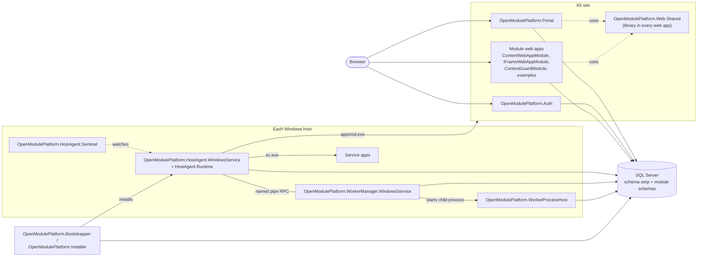
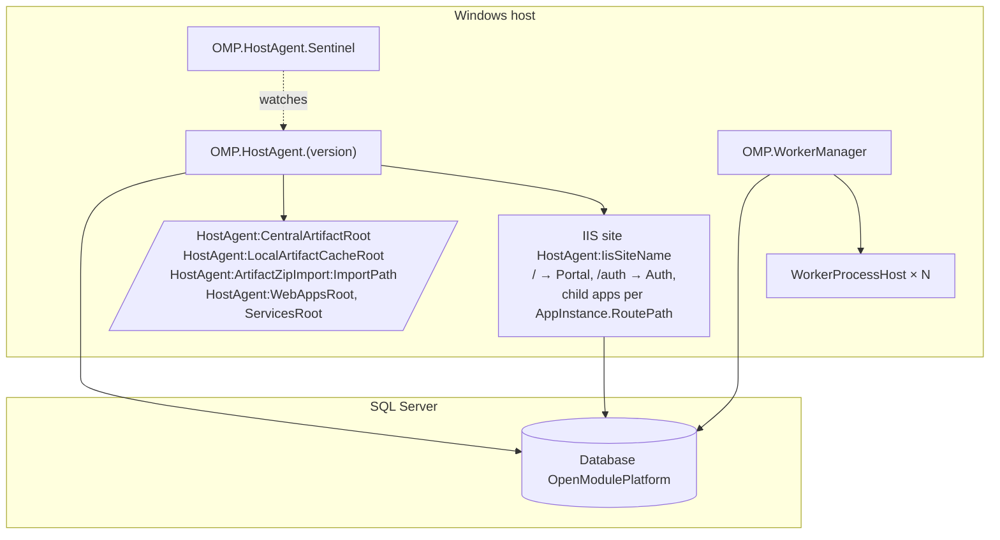
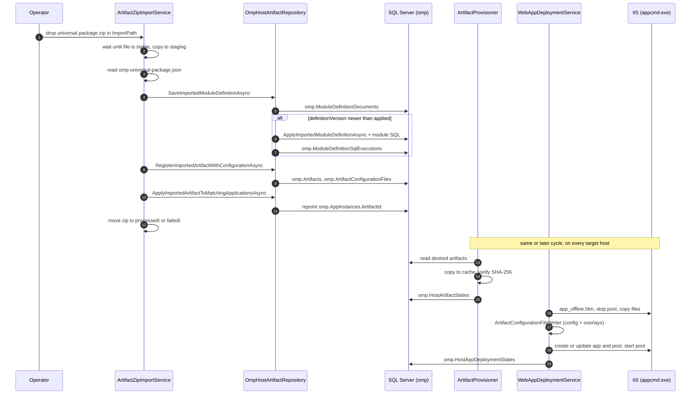
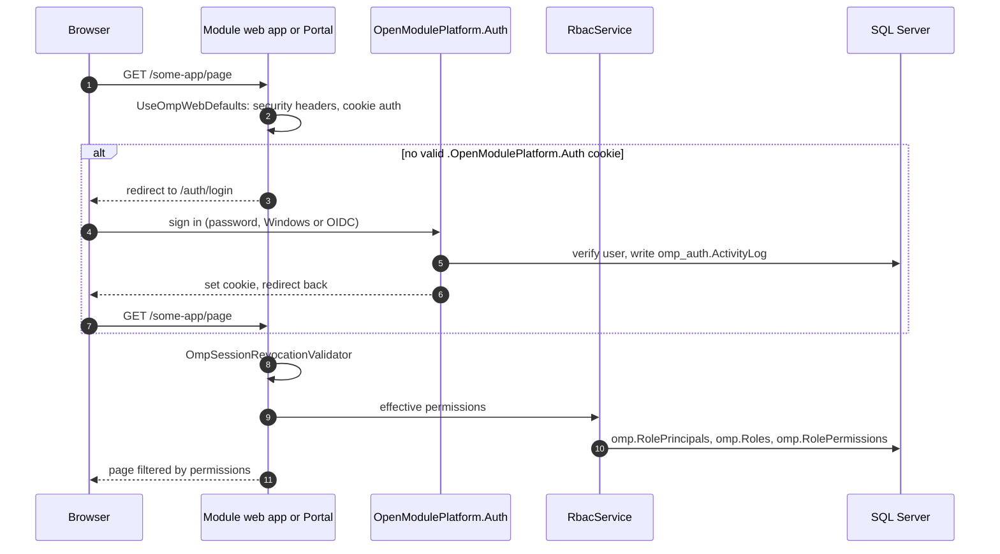
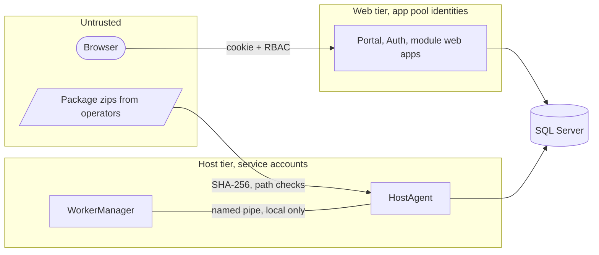

# Architecture

This is the architecture description of OpenModulePlatform (OMP). It is written
for three readers: a newcomer, an architect who evaluates the platform, and an
AI agent that changes it. Every statement names the file or folder it comes
from. Statements that could not be checked in the code are marked
**unverified**. Topic documents go deeper; this document links to them instead
of repeating them.

The description reflects the code on the `0.3.x` line. The repository version
is `repositoryVersion` in `omp-components.json`.

## Contents

1. [Purpose and scope](#1-purpose-and-scope)
2. [Components](#2-components)
3. [Runtime view](#3-runtime-view)
4. [Data](#4-data)
5. [Integration points](#5-integration-points)
6. [Configuration](#6-configuration)
7. [Security model](#7-security-model)
8. [Build, packaging, versioning and deployment](#8-build-packaging-versioning-and-deployment)
9. [Operations](#9-operations)
10. [Known limits and trade-offs](#10-known-limits-and-trade-offs)
11. [Requested follow-ups](#11-requested-follow-ups)

## 1. Purpose and scope

OMP is a Windows platform for hosting modular web applications, Windows
services and plugin workers from one SQL Server database. The database holds
both what *should* run (desired state) and what *does* run (observed state). A
HostAgent service on each host reads the desired state and makes the host match
it.

The core model has four layers:

1. **Definitions** describe what can exist: modules, apps, artifacts and module
   definition documents (`omp.Modules`, `omp.Apps`, `omp.Artifacts`,
   `omp.ModuleDefinitionDocuments`).
2. **Instances** describe what exists in one installation: `omp.Instances`,
   `omp.ModuleInstances`, `omp.AppInstances`, `omp.WorkerInstances`,
   `omp.Hosts`.
3. **Runtime** describes what runs, where, and how it is observed:
   `omp.AppInstanceRuntimeStates`, `omp.WorkerInstanceRuntimeStates`,
   `omp.HostArtifactStates`, `omp.HostAppDeploymentStates`.
4. **Topology** describes desired placement that HostAgent materializes into
   instance rows: `omp.InstanceTemplates`, `omp.InstanceTemplateAppInstances`
   and related tables.

The central design choice is that `omp.AppInstances` is the runtime unit. Route,
host placement, artifact version, configuration id and desired state live on
the app instance, not on the app definition. The Portal app catalogue is built
from `omp.AppInstances` (`OpenModulePlatform.Portal/Services/AppCatalogService.cs`).

### What OMP deliberately does not do

- It does not run on Linux or macOS. HostAgent deploys through IIS
  (`appcmd.exe`, `OpenModulePlatform.HostAgent.Runtime/Services/IisAppCmd.cs`)
  and the Windows service control manager (`sc.exe`,
  `WindowsServiceControl.cs`). The installers target `net10.0-windows`.
- It does not use containers. A host is a Windows machine registered in
  `omp.Hosts`.
- It has no schema-migration framework. `sql/1-setup-openmoduleplatform.sql` is
  idempotent and creates each object only when it is missing; module SQL
  changes travel inside versioned module definitions (section 8).
- It does not sign packages. Integrity rests on the SHA-256 stored in
  `omp.Artifacts.Sha256` and the `sha256` of each embedded SQL script
  (section 7).
- It does not hold customer-specific code. Consumer repositories build their
  own modules against the shared projects (`AGENTS.md`).
- It is not a finished product. `SECURITY.md` lists the supported versions.

## 2. Components

### Component diagram

The arrows come from the files cited in the table below and in section 3.

### Projects

| Project | Responsibility | Depends on |
|---|---|---|
| `OpenModulePlatform.Portal` | Landing page, app catalogue and all administration pages (`Pages/Admin/*`). Imports packages and artifacts. Runs the push-event dispatcher. Exposes `/health/live` and `/health/ready` (`Program.cs`). | `Web.Shared`, `Artifacts`, `EventPublisher.Sql` |
| `OpenModulePlatform.Auth` | Sign-in app. Issues the shared OMP cookie. Pages `/login` and `/ad`; endpoints `POST /logout`, `GET /session-status`, `GET /runtime-versions` (`Program.cs`). Module key `omp_auth`. | `Web.Shared` |
| `OpenModulePlatform.Web.Shared` | Shared web baseline: `AddOmpWebDefaults` / `UseOmpWebDefaults` (`Extensions/OmpWebHostingExtensions.cs`), cookie authentication, `RbacService`, security headers and CSP, NLog setup, SQL connection factory, push-event hub, `OmpConfigurationService`, `OmpTime`. | `EventPublisher.Sql` |
| `OpenModulePlatform.Web.Shared.Analyzers` | Roslyn analyzer that checks web apps call the OMP web defaults (`OmpWebDefaultsAnalyzerTests` in the test project). | — |
| `OpenModulePlatform.Web.ContentWebAppModule` | Database-backed HTML, Markdown and report pages; route `{*slug}` (`Pages/Page.cshtml`). | `Web.Shared` |
| `OpenModulePlatform.Web.iFrameWebAppModule` | Renders database-backed iframe targets inside the OMP shell (`Pages/Index`, `/standalone/{urlId}`). | `Web.Shared` |
| `OpenModulePlatform.Web.ContextGuardModule` | One-time application-context hand-off with heartbeat and supersede (`Hosting/ContextGuardEndpointExtensions.cs`). State is in process memory (`InMemoryContextStore`, `InMemoryHandoffStore`). See `CONTEXT_GUARD_MODULE.md`. | `Web.Shared` |
| `OpenModulePlatform.HostAgent.WindowsService` | Windows service host for the HostAgent (`Program.cs`, service name `OMP.HostAgent` unless `--service-name=` is given). Registers the hosted services listed in section 3. | `HostAgent.Runtime` |
| `OpenModulePlatform.HostAgent.Runtime` | The HostAgent engine: `HostAgentEngine.RunOnceAsync`, artifact import and provisioning, IIS and service deployment, config file writing, jobs, telemetry (`Services/*`). | `Artifacts`, `shared/*` linked sources |
| `OpenModulePlatform.HostAgent.Sentinel` | .NET Framework 4.8 watchdog service `OMP.HostAgent.Sentinel`. Writes Application event log entries when HostAgent is down (`Program.cs`, `SentinelPolicy.cs`). Never restarts HostAgent itself. | — |
| `OpenModulePlatform.WorkerManager.WindowsService` | Service `OMP.WorkerManager` (`Program.cs`). Reconciles worker processes on its host and publishes their observed state (`Services/WorkerManagerHostedService.cs`). | `Worker.Abstractions` |
| `OpenModulePlatform.WorkerProcessHost` | Child process that loads one worker plugin into an `AssemblyLoadContext` (`Plugins/WorkerPluginLoadContext.cs`, `Plugins/WorkerModuleLoader.cs`). | `Worker.Abstractions`, `EventPublisher.Abstractions` |
| `OpenModulePlatform.Worker.Abstractions` | Public plugin contract: `IWorkerModuleFactory`, `IWorkerModule`, `IWorkerDrainCoordinator`, `WorkerExecutionContext` (`Contracts/`). | — |
| `OpenModulePlatform.EventPublisher.Abstractions` / `.Sql` | Push-event publisher contract and its SQL outbox implementation `SqlPushEventPublisher` (writes `omp.push_event_outbox`). | — |
| `OpenModulePlatform.Artifacts` | Reads and writes artifact packages and universal packages (`ArtifactPackageWriter.cs`, `ArtifactPackageExtractor.cs`, `UniversalModulePackageReader.cs`, `ModuleDefinitionApplyOrder.cs`). | — |
| `OpenModulePlatform.Installation` | Shared install engine `InstallationEngine` (`.Sql`, `.Artifacts`, `.HostAgent`, `.Services`, `.CoreMaintenance` partial files) and the `BootstrapConfig` model (`InstallationConfiguration.cs`). | `Artifacts` |
| `OpenModulePlatform.Bootstrapper` | HostAgent-first installer for bootstrap, upgrade and maintenance; GUI without arguments, CLI with `--config` and others (`Program.cs`, `Program.Gui.cs`). See `HOST_AGENT_FIRST_INSTALL.md`. | `Installation` |
| `OpenModulePlatform.Installer` | First-install-only WinForms installer for prepared new-server packages (`Ui/MainForm.cs`, `InstallOrchestrator.RunAsync`). See `FIRST_INSTALLER.md`. | `Installation` |
| `shared/` | Source files linked into several projects: module-definition SQL ownership and completion, runtime maintenance, `PortalAppEntrySync.cs`, `PlatformConfigurationMigration.cs`. | — |
| `integrations/ModuleFragments/` | `OmpModuleFragmentAttribute`, authorization for HTML fragments that module apps serve to the Portal. Linked into the Portal and the web app example. | — |
| `tools/ModuleSqlGuard/` | Console check of module SQL ownership, run by `scripts/omp/Test-ModuleSqlGuards.ps1` in CI. | — |
| `examples/*` | Four reference modules: `WebAppModule`, `WebAppBlazorModule`, `ServiceAppModule` (web app plus Windows service), `WorkerAppModule` (web app plus worker plugin). | `Web.Shared`, `Worker.Abstractions` |

Test projects are listed in section 8.

## 3. Runtime view

### Processes on a host

| Process | Kind | Started by |
|---|---|---|
| `OMP.HostAgent.<version>` | Windows service, one per host | Bootstrapper on first install; HostAgent self-upgrade later (`HostAgentSelfUpgradeService.ResolveServiceName`) |
| `OMP.HostAgent.Sentinel` | Windows service | `scripts/omp/Install-HostAgentSentinel.ps1`; also packaged as service-app component `omp-hostagent-sentinel` (`omp-components.json`) |
| IIS worker processes for Portal, Auth and module web apps | IIS application pools, prefix `OMP_` (`HostAgentSettings.IisAppPoolNamePrefix`) | HostAgent (`WebAppDeploymentService`) |
| Service apps | Windows services | HostAgent (`ServiceAppDeploymentService`) |
| `OMP.WorkerManager` | Windows service | HostAgent, as service-app component `omp-workermanager-service` (`omp-components.json`) |
| `OpenModulePlatform.WorkerProcessHost` | Hidden child process, one per worker instance | WorkerManager (`WorkerManagerHostedService.CreateWorkerProcess`) |

The HostAgent service registers four hosted services, in this order
(`OpenModulePlatform.HostAgent.WindowsService/Program.cs`):

1. `HostAgentHostedService` — the main reconcile loop.
2. `MaintenanceScanScheduler` — maintenance scans, default every 1440 minutes.
3. `SystemLogRetentionService` — prunes `omp.SystemLog`, default 90 days.
4. `HostAgentRpcHostedService` — named-pipe RPC server, pipe
   `OpenModulePlatform.HostAgent.{HostKey}` (`HostAgentSettings.ResolveRpcPipeName`).

### Deployment view

One database serves every host. Each host runs its own HostAgent. A host is
selected by `HostAgent:HostKey`, which falls back to the machine name
(`HostAgentSettings.cs`). Folder settings have no defaults in code. The sample
bootstrap configuration sets them (`installer/hosts/sample/bootstrap.json`,
`scripts/deployment/hostagent-first.config.sample.psd1`).

### Flow 1: one HostAgent cycle

`HostAgentHostedService.ExecuteAsync` calls `HostAgentEngine.RunOnceAsync`
every `HostAgent:RefreshSeconds` (default 30). An exception is logged and the
loop continues. The steps, from
`OpenModulePlatform.HostAgent.Runtime/Services/HostAgentEngine.cs`:

1. Read the desired self-upgrade from `omp.HostAgentDesiredStates`.
2. Acquire the host lease in `omp.HostAgentLeases`. Skip the cycle if the host
   is not registered and enabled, or another HostAgent holds the lease.
3. Publish `omp.HostAgentRuntimeStates`. Complete a pending takeover, if any.
4. Stop here if a quiesce was requested.
5. Set `omp.Hosts.LastSeenUtc` (heartbeat).
6. Import packages from the import folder (`ArtifactZipImportService.ImportPendingAsync`).
7. Claim and run one `omp.HostDeployments` row, if `ProcessHostDeployments` is on.
8. Run `omp.MaterializeInstanceTemplate`, if `MaterializeTemplates` is on.
9. Build the desired artifact set from `omp.AppInstances`, `omp.WorkerInstances`
   and `omp.HostArtifactRequirements`, capped at `MaxArtifactsPerCycle` (100).
10. Check deploy-set consistency (`DeploySetConsistencyService.CheckAsync`,
    ADR 0002).
11. Provision each artifact into the local cache and record
    `omp.HostArtifactStates` (`ArtifactProvisioner`).
12. Under an `omp.AppDeploymentLeases` lease: deploy web apps, probe the Portal
    health endpoint, deploy service apps, and record
    `omp.HostAppDeploymentStates`.
13. Prepare a HostAgent self-upgrade if one is desired; mirror configured files.
14. Run up to five `omp.HostAgentJobs`.
15. Collect host resource telemetry (`HostResourceCollector`).

[`README.md`](../README.md#one-hostagent-cycle), section "One HostAgent cycle", has the same flow as a sequence
diagram. `HOST_AGENT.md` has the details.

### Flow 2: from package to running app

This is the main flow of the platform. It shows how a new version reaches a
running web app.

Sources: `ArtifactZipImportService.cs`, `OmpHostArtifactRepository.cs`,
`ArtifactProvisioner.cs`, `WebAppDeploymentService.cs`, `IisAppCmd.cs`,
`ArtifactConfigurationFileWriter.cs`, all under
`OpenModulePlatform.HostAgent.Runtime/Services/`.

Facts about the import step (`ArtifactZipImportService.cs`):

- Import is off unless `HostAgent:ArtifactZipImport:IsEnabled` is true.
- Only `*.zip` files that do not start with `~` are read. A file must be at
  least 10 seconds old and keep its size for 10 seconds.
- Only universal packages (with `omp-universal-package.json`) are accepted.
- A package with any failed item moves to `failed\` with an `.error.txt` file.
  Otherwise it moves to `processed\`.
- Module definitions apply in `ModuleDefinitionApplyOrder` order, with
  `omp_core` first.

The Portal (`Pages/Admin/ModulePackageImport`, `PortableModulePackageService`)
and the Bootstrapper (`RunBootstrapAsync`) read the same package format.
[`README.md`](../README.md#package-flow-from-source-to-a-running-app), section "Package flow", shows all three entry points.

### Flow 3: an authenticated web request

Sources: `OpenModulePlatform.Web.Shared/Extensions/OmpWebHostingExtensions.cs`,
`Services/RbacService.cs`, `Security/OmpAuthDefaults.cs`,
`OpenModulePlatform.Auth/Program.cs`, `Pages/Login.cshtml`.

### Flow 4: a worker

1. WorkerManager reads its desired workers every `RefreshSeconds` (default 15)
   with inline SQL (`Services/OmpDatabaseWorkerInstanceCatalog.cs`). The query
   unions explicit `omp.WorkerInstances` rows with one implicit worker per
   `omp.AppInstances` row that has none. It requires
   `omp.AppWorkerDefinitions.RuntimeKind = 'windows-worker-plugin'`.
2. A worker is eligible when it is enabled, allowed and its `DesiredState`
   matches. A row whose host role resolves to more than one host is rejected.
   One broken row does not stop the others.
3. WorkerManager starts `OpenModulePlatform.WorkerProcessHost` hidden
   (`CreateNoWindow = true`) with `--WorkerProcess:*` arguments. The
   configuration JSON and the connection string go through environment
   variables, not the command line (`WorkerManagerHostedService.cs`).
4. Each child runs in a Windows job object that kills it when the manager dies
   (`Runtime/ManagedWorkerProcess.cs`).
5. Manager and child talk through three named events: shutdown, drain and busy
   (`OpenModulePlatform.WorkerShutdown.{id}` and siblings). There is no pipe or
   stdin channel.
6. The child loads the plugin, checks `omp-worker-plugin.json` for host-version
   compatibility, and resolves exactly one `IWorkerModuleFactory` whose
   `WorkerTypeKey` matches (`Plugins/WorkerModuleLoader.cs`).
7. WorkerManager writes `omp.WorkerInstanceRuntimeStates` and recomputes
   `omp.AppInstanceRuntimeStates` (`Services/OmpWorkerRuntimeRepository.cs`).
   States are 0 Unknown, 1 Starting, 2 Running, 3 Stopping, 4 Stopped,
   5 Failed, 6 Draining (`Models/WorkerObservedStates.cs`).
8. A worker restarts at most `MaxRestartsPerWindow` (5) times per
   `RestartWindowSeconds` (300), at least `RestartDelaySeconds` (5) after an
   exit. The policy is a sliding window, not exponential back-off.

See `WORKER_RUNTIME.md` for details. The classic service example
(`examples/ServiceAppModule/ServiceApp`) runs without WorkerManager. It reads
its own `AppInstanceId` from `appsettings.json` and its runtime row through
`Services/AppInstanceRepository.cs`.

## 4. Data

### Stores

| Store | What it holds | Owner |
|---|---|---|
| SQL Server, schema `omp` | Platform catalogue, instances, topology, runtime state, RBAC, users, config, audit, logs, telemetry. Created by `sql/1-setup-openmoduleplatform.sql`, seeded by `sql/2-initialize-openmoduleplatform.sql`. | Platform core (`omp_core.module-definition.json`) |
| SQL Server, module schemas | One schema per module, for example `omp_auth`, `omp_portal`, `omp_content`, `omp_iframe`, `omp_example_*`. Created by each module's `Sql/1-setup-*.sql`. | The module, through its module definition |
| Central artifact store | Registered artifact zips. Setting `HostAgent:CentralArtifactRoot`; Portal `ArtifactUpload:ArtifactStoreRoot`. | HostAgent and Portal |
| Local artifact cache | Verified copies per host. Setting `HostAgent:LocalArtifactCacheRoot`. | HostAgent |
| Import folder | Incoming universal packages, `processed\`, `failed\`. Setting `HostAgent:ArtifactZipImport:ImportPath`. Archives are pruned after 30 days or above 4 GiB. | HostAgent |
| Deployed app folders | `HostAgent:WebAppsRoot`, `PortalPhysicalPath`, `ServicesRoot`. Each web app gets `App_Data/omp-deployment.lock.json` (`DeploymentLockFile.cs`). | HostAgent |
| Data Protection key ring | Shared cookie keys. `OmpAuth:DataProtectionKeyPath`, fallback `<runtime>\DataProtectionKeys` (`ResolveDataProtectionKeyPath` in `OmpWebHostingExtensions.cs`). | Web apps |
| HostAgent credential store | DPAPI-protected credentials, `LocalMachine` scope (`HostAgentSettings.CredentialStore`). | HostAgent |
| Process memory | Login throttling (`LoginThrottleService`), Context Guard stores, `OmpConfigurationService` cache. Lost on restart. | Each web app |
| Log files | NLog files, see section 9. | Each process |

### Tables in schema `omp`

The grouping is editorial; every table is created in
`sql/1-setup-openmoduleplatform.sql`.

| Group | Tables |
|---|---|
| Definitions | `Modules`, `Apps`, `AppPermissions`, `AppWorkerDefinitions`, `Artifacts`, `ArtifactConfigurationFiles`, `ModuleDefinitionDocuments`, `ModuleDefinitionArtifactCompatibility`, `ModuleDefinitionConsistentArtifactSets`, `ModuleDefinitionConsistentArtifactSetMembers`, `ModuleDefinitionSqlExecutions` |
| Instances | `Instances`, `ModuleInstances`, `AppInstances`, `WorkerInstances`, `Hosts` |
| Topology (desired) | `InstanceTemplates`, `HostTemplates`, `InstanceTemplateHosts`, `InstanceTemplateModuleInstances`, `InstanceTemplateAppInstances`, `HostDeploymentAssignments`, `HostDeployments`, `HostArtifactRequirements` |
| Runtime (observed) | `AppInstanceRuntimeStates`, `WorkerInstanceRuntimeStates`, `HostAgentRuntimeStates`, `HostAgentLeases`, `HostAgentJobs`, `HostAgentDesiredStates`, `AppDeploymentLeases`, `WebAppHealthStates`, `HostAppDeploymentStates`, `HostArtifactStates` |
| Auth and RBAC | `users`, `user_auth`, `auth_providers`, `auth_provider_lpwd`, `Permissions`, `Roles`, `RolePermissions`, `RolePrincipals` |
| Configuration | `config_setting_definitions`, `config_settings`, `ConfigOverlayDocuments`, `ConfigOverlayConfigurationFiles`, `HostConfigurationDocuments` |
| Messaging and UI | `push_event_outbox`, `notifications`, `messages`, `message_attachments`, `conversations`, `conversation_participants`, `direct_conversations`, `banners`, `banner_targets`, `link_boxes`, `link_box_items` |
| Audit, logs, telemetry | `AuditLog`, `SystemLog`, `MaintenanceFindings`, `PerformanceSamples`, `PerformanceSamplesDaily`, `HostResourceSamples`, `HostResourceSamplesDaily`, `HostResourceLatest`, `QueryCostSnapshots` |

Important procedures: `omp.MaterializeInstanceTemplate`,
`omp.RequestHostDeployment`, `omp.RollUpAndPrunePerformanceSamples`,
`omp.PruneHostResourceSamples`, `omp.CaptureQueryCostSnapshot`.

### Key rows

`omp.AppInstances` carries `HostId`, `TargetHostTemplateId`, `ArtifactId`,
`ConfigId`, `RoutePath`, `PublicUrl`, `InstallPath`, `InstallationName`,
`DesiredState`, the expected runtime identity (`ExpectedLogin`,
`ExpectedClientHostName`, `ExpectedClientIp`) and observed values
(`LastSeenUtc`, `LastLogin`, `LastClientHostName`, `LastClientIp`,
`VerificationStatus`).

`ConfigId` points into a module-owned configuration table (ADR 0001). It is
not the key of `omp.config_settings`.

`omp.Hosts.BaseUrl` is optional. The Portal uses it to build a link for an app
instance with a relative `RoutePath` (`AppCatalogService.cs`).

Desired app placement targets one host (`HostId`), one host role
(`TargetHostTemplateId` through `omp.HostDeploymentAssignments`), or no host.
Host-neutral placement is for web apps that share one load-balanced identity.

### Installation profile

`omp.InstanceTemplates` is the installation profile. The Portal lists and edits
every profile (`Pages/Admin/InstanceTemplates.cshtml.cs`). The profile that
applies is the one referenced by an enabled `omp.Instances` row.
`omp.MaterializeInstanceTemplate` turns profile rows into `omp.ModuleInstances`
and `omp.AppInstances`. It matches existing rows on `ModuleInstanceId` and
`AppInstanceKey`; there is no column that records which template row created an
instance (`sql/1-setup-openmoduleplatform.sql`, `MERGE omp.AppInstances`).

### File formats

| Format | Manifest | Reader / writer |
|---|---|---|
| Artifact package | `omp-artifact-package.json`, `formatVersion` 1, payload `payload/artifact.zip`. File name `module__app__packageType__target__version.zip`. | `ArtifactPackageWriter`, `ArtifactPackageExtractor`, `OmpArtifactNaming` |
| Universal package | `omp-universal-package.json`, `formatVersion` 1, folders `module-definitions/`, `artifacts/`, `host-configs/`, `config-overlays/`, `widgets/`, `widget-data/`. Manifest up to 1 MB, up to 10,000 entries. | `UniversalModulePackageReader` |
| Module definition | `*.module-definition.json`: `moduleKey`, `definitionVersion`, `module`, `apps`, `compatibleArtifacts`, `consistentArtifactSets`, `sqlScripts` (with base64 `content` and `sha256`), `integrity`, optional `runtimeMaintenance`. | `InstallationEngine.Sql.cs`, `ArtifactZipImportService.cs`, `OmpAdminRepository.Editor.cs` |
| Component manifest | `omp-components.json`: `repositoryVersion`, `moduleDefinitions`, `sharedProjects`, `components` (each with `componentKey`, `packageType`, `version`, `minModuleDefinitionVersion`, `projectPath`). | `scripts/omp/*.ps1` |
| Worker plugin manifest | `omp-worker-plugin.json`: `FormatVersion`, `WorkerHost{ComponentKey, MinVersion}`. | `WorkerPluginCompatibilityManifest` |

Details: `ARTIFACT_PACKAGES.md`, `UNIVERSAL_MODULE_PACKAGES.md`,
`MODULE_DEFINITIONS.md`, `OMP_COMPONENT_MANIFEST.md`.

## 5. Integration points

| Counterpart | Direction | Contract |
|---|---|---|
| SQL Server | All processes use it | Connection string `ConnectionStrings:OmpDb` (`Web.Shared/Services/SqlConnectionFactory.cs`). Default connect timeout 5 s, command timeout 30 s. |
| IIS | HostAgent writes | `appcmd.exe` for sites, apps, virtual directories and pools; `Microsoft.Web.Administration.ServerManager` loaded by reflection for identity and authentication (`IisAppCmd.cs`, `WebAppDeploymentService.cs`). |
| Windows service control manager | HostAgent writes | `sc.exe` create, config, start and stop (`WindowsServiceControl.cs`). |
| Active Directory / Windows | Auth reads | `/ad` uses IIS Windows authentication, or Negotiate outside IIS. Alternate credentials use `PrincipalContext.ValidateCredentials` (`WindowsPasswordAuthenticator`). |
| OIDC provider (for example AD FS) | Auth reads, optional | `OmpAuth:Oidc` (`OmpOidcAuthenticationExtensions`). |
| Consumer repositories (modules built outside this repository) | Depend on OMP | They reference `OpenModulePlatform.Web.Shared` and `Worker.Abstractions`, ship `*.module-definition.json` and artifact packages, and import them as universal packages. Builds use `-p:OmpIsolatedBuildRoot` (`AGENTS.md`, ADR 0003). |
| OpenDocViewer | Optional viewer, hosted beside OMP | Example endpoint `GET opendocviewer-demo/bundle` returns a JSON bundle (`session`, `documents[].files[]`, `integration{mode:"sessionurl"}`). The viewer is opened as `{OpenDocViewer:BaseUrl}?sessionurl=<bundle url>` (`Web.Shared/OpenDocViewer/*`). The Bootstrapper stamps a SHA-384 integrity value on the viewer bootstrap script (`OpenDocViewerArtifactIntegrity.cs`). See `OPEN_DOC_VIEWER_EXAMPLES.md`. |
| Calling systems for Context Guard | Inbound HTTP | `POST /handoff/{profileKey}`, `POST /context/{id}/heartbeat`, `GET /context/{id}/state` (`ContextGuardEndpointExtensions.cs`). |
| Browsers, push events | Outbound | SignalR hub `TopBarNotificationHub` at `/topbar/notifications/updates` and `/push/events`, methods `notificationStateChanged` and `pushEvent` (`OmpWebHostingExtensions.cs`). |
| Azure Trusted Signing | Build time, optional | `scripts/deployment/sign-artifacts.ps1` with `signtool` (`CODE_SIGNING.md`). |

### Ports

- IIS binding defaults to `http` on port 80 (`HostAgentSettings.IisBindingPort`).
  The sample bootstrap uses port 8088 (`installer/hosts/sample/bootstrap.json`).
- Local development: Portal on `http://localhost:5070`, iFrame on 5075, examples
  on 5071 and 5072 (`Properties/launchSettings.json`).
- HostAgent RPC uses a local named pipe, not a network port.

## 6. Configuration

### Where settings live

| Layer | Location | Read by |
|---|---|---|
| App settings | `appsettings.json` per project; `Packaging/appsettings.json` for packaged web apps; `appsettings.Production.json` written by the installer for HostAgent (`InstallationEngine.HostAgent.cs`). | Standard .NET configuration |
| Environment variables | Standard ASP.NET Core and .NET host binding; no custom prefix. WorkerManager passes `ConnectionStrings__OmpDb` and `WorkerProcess__ConfigurationJson` to child processes. | Standard .NET configuration |
| Artifact configuration files | `omp.ArtifactConfigurationFiles`, written into the deployed folder by HostAgent. | `ArtifactConfigurationFileWriter` |
| Config overlays | `omp.ConfigOverlayDocuments` and `omp.ConfigOverlayConfigurationFiles`, matched on host, module, app, package type and target. | HostAgent (`OmpHostArtifactRepository.BuildConfigurationFilesSql`) |
| Database settings | `omp.config_settings` with `omp.config_setting_definitions`. | `Web.Shared/Services/OmpConfigurationService.cs` |
| Module configuration | Module-owned tables addressed by `AppInstances.ConfigId`. | The module |

### Precedence

- Configuration files on disk: artifact configuration first, then an
  `AllHosts` overlay, then an exact-host overlay, per relative path
  (`BuildConfigurationFilesSql` source priorities 0, 1, 2; ADR 0007;
  `CONFIG_OVERLAYS.md`). Each file has a `MergeMode` (ADR 0006).
- Database settings: user scope beats permission scope, which beats role scope,
  which beats global scope. Then higher `ConfigPriority`, then higher
  `ConfigId` (`OmpConfigurationService.cs`). Values are cached for two minutes.
- Within a .NET process the standard order applies: `appsettings.json`, then
  the environment file, then environment variables, then command-line
  arguments.

### Settings with the largest effect

| Setting | Effect | Source |
|---|---|---|
| `ConnectionStrings:OmpDb` | Which database every process uses. | `SqlConnectionFactory.cs` |
| `HostAgent:HostKey` | Which `omp.Hosts` row the HostAgent acts for. | `HostAgentSettings.cs` |
| `HostAgent:DeployWebApps`, `DeployServiceApps` | Off in code; on in the sample bootstrap. When off, HostAgent provisions artifacts but deploys nothing. | `HostAgentSettings.cs`, `installer/hosts/sample/bootstrap.json` |
| `HostAgent:MaterializeTemplates`, `ProcessHostDeployments`, `ProcessHostAgentJobs` | Turn the topology and job steps of the cycle on or off (default on). | `HostAgentSettings.cs` |
| `HostAgent:RequireArtifactHash` | When true, an artifact without a catalogue hash is refused (default false). | `HostAgentSettings.cs` |
| `HostAgent:DeploySetConsistencyMode` | `Warn` (default) or `Block` for mixed artifact sets. | ADR 0002 |
| `OmpAuth:*` | Cookie security policy, key ring path, key protection, OIDC. | `Web.Shared/Options/OmpAuthOptions.cs` |
| `<section>:AllowAnonymous` | When false, a fallback authorization policy requires sign-in. | `OmpWebHostingExtensions.cs` |
| `<section>:UseForwardedHeaders` and `ForwardedHeaders*` | Trust of proxy headers. | `OmpWebHostingExtensions.cs` |
| `<section>:SecurityHeaders:ContentSecurityPolicy:ReportOnly` | CSP enforcement; report-only by default. | `Options/SecurityHeadersOptions.cs`, `CONTENT_SECURITY_POLICY.md` |
| `PushEvents:Dispatcher:Enabled` | Whether this process delivers queued push events. Only the Portal enables it. | `OpenModulePlatform.Portal/appsettings.json` |
| `OmpTime:TimeZoneId` | Display time zone; storage stays UTC. Default `UTC`. | `Web.Shared/Services/OmpTime.cs`, `TIME_ZONE.md` |
| `WorkerManager:CatalogMode` | `OmpDatabase` or `Configuration` worker catalogue. | `Models/WorkerManagerSettings.cs` |

`ADMIN_CONFIGURATION.md` and `CONFIG_OVERLAY_ADMINISTRATION.md` describe the
Portal side.

## 7. Security model

Full detail: `AUTHENTICATION_AND_RBAC.md` and `CONTENT_SECURITY_POLICY.md`.

### Authentication

- `OpenModulePlatform.Auth` is the only app that signs users in. Other web apps
  run with IIS anonymous access and validate the shared cookie in code.
  HostAgent turns on IIS Windows authentication only for the `/auth` app
  (`WebAppDeploymentService.cs`).
- The cookie is `.OpenModulePlatform.Auth`, scheme `OmpAuth`
  (`Security/OmpAuthDefaults.cs`). It is HttpOnly, SameSite=Lax, Secure by
  default, valid for 10 hours, and not sliding (`OmpWebHostingExtensions.cs`).
- All web apps share the cookie because they share the Data Protection
  application name (`OmpAuth:ApplicationName`, default `OpenModulePlatform`)
  and key ring folder.
- Every request re-checks the user and a security stamp
  (`OmpSessionRevocationValidator`), so an administrator can revoke sessions.
- Providers:
  - Local password (`lpwd`): PBKDF2-SHA256, 210,000 iterations by default,
    32-byte salt (`Web.Shared/Security/LocalPasswordHasher.cs`), stored in
    `omp.auth_provider_lpwd`.
  - Windows / AD through `/ad`.
  - Optional OIDC.
- Failed sign-ins are throttled in memory: 10 failures per account or 50 per
  client IP within 15 minutes give a 15-minute lockout
  (`Auth/Services/LoginThrottleService.cs`).

### Authorization

- RBAC uses `omp.Permissions`, `omp.Roles`, `omp.RolePermissions` and
  `omp.RolePrincipals` (`Services/RbacService.cs`).
- A request's principals are: the system principal `Everyone`;
  `AuthenticatedUsers` for signed-in users whose domain is on an allowlist
  (fails closed); `OmpUser:<id>`; and for Windows identities `User`, `ADUser`
  and `ADGroup`. Large AD groups need no `omp.users` rows.
- Roles are ambient or selectable. Effective permissions are those of all
  ambient roles plus the active selectable role, chosen through the
  `omp_active_role` cookie.
- Permissions are computed once per request; there is no cross-request cache.
  A SQL error yields no permissions.
- Module HTML fragments served to the Portal are authorized by
  `OmpModuleFragmentAttribute` (`integrations/ModuleFragments/`).

### Trust boundaries

- Browser to web app: the cookie, RBAC, security headers and CSP
  (`UseOmpSecurityHeaders`).
- Proxy to web app: `X-Forwarded-For` is trusted only from configured proxies
  or networks.
- Package to host: SHA-256 against `omp.Artifacts.Sha256`; reparse points are
  refused; HostAgent refuses to write its own control paths through overlays
  (`ArtifactProvisioner.cs`, `ArtifactZipImportService.cs`, `CanonicalRelativePath.cs`, `ArtifactConfigurationFileWriter.cs`).
- Process to database: each process uses its own connection string. The
  Bootstrapper grants runtime accounts `db_datareader` and `db_datawriter`
  (`EnsureRuntimeDatabaseAccessAsync`). Artifact ownership by database
  principal is covered in ADR 0005.
- HostAgent RPC: a named pipe with an ACL (`HostAgentRpcHostedService`).
- Secrets: HostAgent keeps credentials in a DPAPI store. The Data Protection
  key ring is **not** encrypted at rest unless DPAPI, DPAPI-NG or a certificate
  is configured; the app logs a startup warning when it is not
  (`ApplyDataProtectionKeyProtection` in `OmpWebHostingExtensions.cs`).

### Audit trail

| Store | What it records | Writer |
|---|---|---|
| `omp.AuditLog` (Actor, Action, TargetType, TargetId, BeforeJson, AfterJson) | Host deployment requests, config overlay changes including deletions, user merges. | `OmpAdminRepository.WriteAuditLogAsync`, `OmpAdminRepository.OverlayAdministration.cs`, `OmpUserAdminRepository.cs` |
| `omp_auth.ActivityLog` | `session.signed_in`, `session.signed_out`, `user.registered`. Failed sign-ins are not recorded here. | `Auth/ActivityLog/ActivityLogWriter.cs`, `Services/SignInActivityLog.cs` |
| `omp_portal.ActivityLog` | Role changes, universal package imports, maintenance scans, HostAgent upgrade requests, app pool recycles, messaging events. | Portal pages and services |
| `omp.ModuleDefinitionSqlExecutions` | Every module SQL script run, with hash and status. | HostAgent, Bootstrapper |
| `omp.SystemLog` | Warnings and errors from all processes except WorkerProcessHost. | NLog database target |

Not every Portal edit writes an audit row. Which admin pages write neither
store is **unverified**.

## 8. Build, packaging, versioning and deployment

### Build

- Projects are listed in `OpenModulePlatform.slnx`. Package versions are
  central in `Directory.Packages.props`.
- `Directory.Build.props` turns on deterministic builds
  (`Deterministic`, `ContinuousIntegrationBuild`, `PathMap`). Assembly version
  is fixed at `0.1.0`; artifact versions come from `omp-components.json`.
  `DETERMINISTIC_BUILDS.md` explains why.
- `OmpIsolatedBuildRoot` moves `obj` and `bin` for parallel consumer builds.
  `Directory.Build.targets` stops a relative path (`OMPBUILD001`) or a path
  inside the repository (`OMPBUILD002`).
- CI is `.github/workflows/ci.yml` with jobs `sbom`, `razor-determinism`,
  `razor-cross-shell`, `module-fragment-ui`, `version-matrix`, `gates` and
  `build-test`, all on Windows. `scripts/local-ci.ps1` runs the same gate
  locally.
- Tests: xUnit projects `*.Tests` for Bootstrapper, HostAgent.Runtime,
  Installation, Installer, Portal, Web.ContextGuardModule,
  Web.Shared.Analyzers, Worker.Abstractions, WorkerManager.WindowsService and
  WorkerProcessHost; Playwright UI tests in `OpenModulePlatform.UiTests`; Pester
  tests and Node tests under `tests/`. Known gaps: `TEST_DEBT.md`.

### Packaging

`omp-components.json` lists 15 components. Their `packageType` is `web-app` (Portal, Auth, Content, iFrame, Context Guard, example web apps), `host-agent` (`omp-hostagent-service`), `service-app` (Sentinel, WorkerManager, service example), `worker-host` (`omp-workerprocesshost`) or `worker` (worker example).

1. `scripts/omp/build-repository-objects.ps1` publishes each component in
   `omp-components.json` and wraps it as an artifact package.
2. `scripts/omp/export-universal-package.ps1` validates module definitions,
   SQL guards and component versions, and writes a universal package.
   `scripts/omp/build-universal-package.ps1` wraps both.
3. `scripts/deployment/package-hostagent-first.ps1` and
   `build-fresh-install-package.ps1` build installer packages.
4. `scripts/deployment/sign-artifacts.ps1` signs first-party binaries when a
   signing configuration is supplied.

### Versioning

- Each component has its own `version` in `omp-components.json`. Each module
  definition has its own `definitionVersion`. The repository has
  `repositoryVersion`.
- `scripts/omp/bump-version.ps1` bumps them together.
  `scripts/omp/validate-component-versions.ps1` checks them.
- A change to a module's SQL must bump `definitionVersion`, re-embed the SQL
  with `scripts/dev/embed-module-definition-sql.ps1`, and raise
  `minModuleDefinitionVersion` where needed (`AGENTS.md`). Import applies a
  definition only when its version is newer than the applied one.
- Policy: `VERSIONING_AND_IDENTITIES.md`.

### Deployment

- **First install.** The Bootstrapper (`RunBootstrapAsync`) optionally creates
  the database, runs the SQL scripts, imports module definitions, grants
  database access, registers artifacts in the central store, and installs
  HostAgent (`InstallationEngine.HostAgent.cs`: copy files, write
  `appsettings.Production.json`, run `--run-once`, create and start the
  service). The Installer adds IIS features, the .NET Hosting Bundle and
  service-account rights first, then runs the same chain without creating the
  database, then waits up to ten minutes for HostAgent's first sync
  (`InstallOrchestrator.RunAsync`).
- **Normal updates.** Drop a universal package in the import folder, or import
  it in the Portal. HostAgent on each host does the rest (Flow 2).
- **HostAgent self-upgrade.** A `host-agent` package sets
  `omp.HostAgentDesiredStates`. HostAgent installs a new versioned service
  `OMP.HostAgent.<version>` in `{SelfUpgrade:InstallRoot}\HostAgent-<version>`
  and hands over through a takeover (`HostAgentSelfUpgradeService.cs`).

Runbooks: `FRESH_INSTALL.md`, `HOST_AGENT_FIRST_INSTALL.md`,
`FIRST_INSTALLER.md`, `HOSTING_WINDOWS_IIS.md`, `PUBLISH_README.md`.

## 9. Operations

### Logs

- Every process uses NLog. Files go to `${basedir}/logs/${appName}-${shortdate}.log`
  and are kept 14 days (`appsettings.json` of each project).
- WorkerProcessHost writes one file per process under
  `${basedir}/../Logs/WorkerProcessHost/` and deletes files older than 14 days
  at start (`WorkerProcessHost/Program.cs`).
- Warnings and errors go to `omp.SystemLog`, except from WorkerProcessHost.
  HostAgent prunes the table after `SystemLogRetentionDays` (90).
- The Sentinel writes the Windows Application event log: 1 recovered, 10 OK,
  100 HostAgent down, 101 more than one HostAgent, 102 no HostAgent,
  103 stale database heartbeat (`SentinelPolicy.cs`).
- Web requests carry a correlation id (`UseOmpRequestCorrelation`).
- Details: `LOGGING.md`.

### Health

- Portal: `GET /health/live` and `GET /health/ready` (503 when not ready).
  Other web apps have no health endpoint.
- HostAgent probes the Portal's `/health/ready` and records
  `omp.WebAppHealthStates` (`WebAppHealthMonitor.cs`). Automatic app pool
  recycle is off by default.
- Host heartbeat: `omp.Hosts.LastSeenUtc`, set by HostAgent and WorkerManager.
- Observed state: `omp.HostAgentRuntimeStates`, `omp.HostArtifactStates`,
  `omp.HostAppDeploymentStates`, `omp.AppInstanceRuntimeStates`,
  `omp.WorkerInstanceRuntimeStates`. The Portal shows them under
  `Pages/Admin/*` (Hosts, HostDeployments, WorkerRuntime, HostResources).

### Upgrade

- Platform and modules: universal package import (section 8).
- Web apps are taken offline with `app_offline.htm` during a deploy, so a short
  outage per app is expected.
- Workers drain before a configuration-driven restart, up to
  `DrainTimeoutSeconds` (900).

### Backup

The repository contains no backup tooling. What must be backed up, by
inference from section 4: the SQL Server database, the central artifact store,
the Data Protection key ring, and the HostAgent credential store. Losing the
key ring signs out every user. Backup procedures are **unverified** and outside
this repository.

### Known failure modes

| Symptom | Cause | Where to look |
|---|---|---|
| Nothing deploys on a host | Host row missing or disabled; another HostAgent holds the lease; `DeployWebApps` off. | `omp.Hosts`, `omp.HostAgentLeases`, `HostAgentSettings.cs` |
| Package stays in import folder | Import disabled, or file still changing. | `HostAgent:ArtifactZipImport`, HostAgent log |
| Package in `failed\` | Any item in it failed; see the `.error.txt` beside it. | `ArtifactZipImportService.cs` |
| New module SQL never runs | `definitionVersion` not bumped. | `omp.ModuleDefinitionDocuments`, `runbooks/schema-ligger-efter-efter-import.md` |
| Artifact marked corrupt | Hash mismatch against `omp.Artifacts.Sha256`. | `ArtifactProvisioner.cs` |
| Mixed versions warned or blocked | Deploy-set consistency check. | ADR 0002 |
| Worker restarts then stops | Restart cap reached (5 per 300 s). | `omp.WorkerInstanceRuntimeStates`, WorkerManager log |
| Worker recycled | Private memory above 1536 MB twice in a row. | WorkerProcessHost log |
| Everyone signed out | Key ring lost or not shared between apps. | `OmpAuth:DataProtectionKeyPath` |
| Event 101 from Sentinel | Two HostAgent services running after an upgrade. | Services console, `HOST_AGENT.md` |

## 10. Known limits and trade-offs

Decisions with their reasons are recorded as ADRs in `docs/adr/`:

| ADR | Decision |
|---|---|
| 0001 | `AppInstances.ConfigId` is a bridge to a module-owned configuration row. |
| 0002 | Deploy-set consistency is checked only where a module declares `consistentArtifactSets`. |
| 0003 | A change in `Web.Shared` cascades version bumps to private consumers. |
| 0004 | Channel-type reconcile is generalized (`CHANNEL_TYPE_RECONCILE.md`). |
| 0005 | Artifact ownership by database principal. |
| 0006 | A config overlay's `ArtifactVersion` is a minimum, not an exact match. |
| 0007 | Config overlays can target all hosts. |

Limits in the code today:

- **One installation profile in practice.** The schema and Portal handle
  several profiles, but the seed data and installers assume one. Several
  profiles are untested.
- **No origin tracking.** Materialized instances are matched to template rows
  by key only (section 4).
- **Opt-in consistency.** Only modules that declare `consistentArtifactSets`
  are checked; today only the ServiceApp example does.
- **`ConfigId` validation is opt-in per module**, because the target table is
  module-owned (ADR 0001).
- **In-memory state.** Login throttling and Context Guard state live in one
  process. They reset on app pool recycle and are not shared between
  load-balanced servers. Context Guard v1 supports one deployed instance per
  route (`CONTEXT_GUARD_MODULE.md`).
- **No package signatures.** Integrity relies on database hashes, and
  `RequireArtifactHash` is off by default.
- **Key ring unencrypted by default.** See section 7.
- **CSP is report-only by default.**
- **Polling, not events.** HostAgent reacts within `RefreshSeconds` (30 s);
  WorkerManager within 15 s.
- **Health endpoints only on the Portal.** Module web apps are not probed.
- **Short outages during deploys** because of `app_offline.htm`.
- **Administration is table-centric** in many Portal pages, and drift
  reporting between desired and observed topology is limited (**unverified**
  beyond the existing runtime-state pages).

Recommended direction, unchanged from earlier versions of this document: keep
`AppInstance` as the runtime unit, keep System > Installation as the main
topology surface, make origin tracking explicit, separate desired from observed
state further, and add multi-profile support only on a concrete need.

## 11. Requested follow-ups

These are gaps found while checking this document against the code. None
changes behaviour today.

1. **Data Protection key protection.** `OmpAuthOptions.ProtectKeysWithDpapi`
   defaults to false, so the shared key ring is stored unencrypted unless an
   operator configures protection. Decide whether production templates should
   enable protection by default.
2. **Health endpoints for module web apps.** Only the Portal maps
   `/health/live` and `/health/ready`. HostAgent's health monitor therefore
   covers the Portal only.
3. **Origin tracking.** `omp.MaterializeInstanceTemplate` matches on
   `ModuleInstanceId` and `AppInstanceKey`. A renamed key creates a new
   instance instead of updating the old one. This document cannot tell whether
   that is intended.
